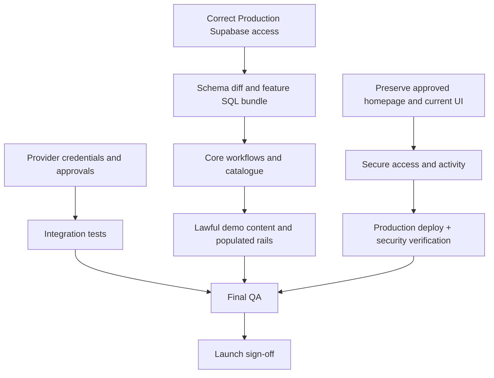

# VISION HUB - Feature Portfolio & Completion Chart

**Snapshot:** 20 November 2026  
**Purpose:** review the current product, identify what is implemented, what is verified, and what remains blocked before starting the next feature batch.

> Status terminology: **Implemented** means code is present; **Provisioned** means an external resource/secret has been configured; **Verified** means a live end-to-end check passed; **Blocked** means a named provider, database access, approval or owner decision is still required.

## Executive summary

VISION HUB already has the primary catalogue experience, member flows, role-based Control Center, player, upload/storage integrations, community and donation surfaces. The main remaining work is not a full redesign: it is production schema reconciliation, real storage/playback validation, legal sample content, provider configuration and the final device/security test pass.

The new security activity system is implemented in code and its Cloudflare D1 database, production binding and signing secret have been provisioned. It still needs the matching production deployment and live negative/positive browser tests before it can be marked **Verified**.

## Portfolio at a glance

| Workstream | Current state | What is still needed |
|---|---|---|
| Homepage and navigation | **Implemented**; desktop layout has been browser-checked | Final phone-size viewport check; keep approved layout unchanged |
| User login and signup | **Implemented** | Resolve confirmation-email SMTP delivery; final signup/login/password-reset tests |
| Secret Admin sign-in | **Implemented**; separate from user login | Verify signed Admin cookie in production and test the 1-hour expiry |
| Admin / staff permissions | **Implemented in shared API guard** | Test every role and verify denied requests are recorded |
| IP, guest and login activity | **D1 provisioned; code implemented** | Deploy current commit; test guest, user, staff, blocked and Main-Admin-only views |
| Catalogue and detail popups | **Implemented** | Publish lawful demo catalogue; validate filters, search, detail popup and empty states |
| Player and playback progress | **Implemented** | Complete B2/Supabase signed playback, quality, subtitles, progress and download tests |
| Backblaze B2 | **Credentials/configuration provisioned; code implemented** | Validate exact-origin CORS and upload -> metadata -> signed read/playback -> delete |
| Cloudflare R2 | **Optional code path implemented** | Add R2 credentials only if this provider is intended to be used |
| Supabase Storage | **Legacy path retained** | Test existing private assets without changing/deleting legacy objects |
| Seasons / episodes / popular ranking / community voting | **Code present** | Apply and verify the feature SQL bundle on the correct Production Supabase project |
| Requests and feedback | **Code present** | Final guest/member submission, moderation, permissions and notification tests |
| Donations | **Code present** | SQL bundle, UPI ID/QR setup and manual bank/UTR verification test |
| Telegram bot and notifications | **Code present** | Bot token, webhook secret, admin chat ID and optional channel ID |
| Google Drive link import | **Code present** | Restricted Google Drive API key and one public shared-file test |
| AdSense | **Placement/report code present** | Google approval, publisher/slot IDs, read-only OAuth secrets and required CMP |
| Legal and privacy | **Policy pages present; security notice updated** | Owner review, legal contact details and applicable consent/CMP setup |
| Performance / accessibility / SEO | **Baseline metadata and layout work present** | Lighthouse, crawl, keyboard, contrast, network and real mobile tests |

## Dependency and phase chart

## Priority backlog

| ID | Priority | Item | Status / dependency | Acceptance condition |
|---|---:|---|---|---|
| SEC-01 | P0 | Deploy secure Admin session cookie + D1 IP activity | Code committed; production deployment/verification pending | Admin panel issues a 1-hour HttpOnly signed cookie; protected APIs reject a staff JWT without it |
| SEC-02 | P0 | Test lockout and role boundaries | Pending live test; D1 provisioned | 5 failed/unauthorised attempts within 30 minutes block that IP for 30 minutes; Main Admin alone can read logs |
| SEC-03 | P0 | Verify guest and member activity capture | Pending live test | Guest visit, user login, staff login, failed login, logout and blocked attempt show server IP + timestamp |
| DB-01 | P0 | Obtain access to the exact Production Supabase project | **Blocked**: website ref is `bmtbsguwbbeuvmvdfdyb`; available connector project is `rcpofawscmxtayrvuqzn` | Verify target project and migration history before any DB write |
| DB-02 | P0 | Apply and validate feature upgrade SQL | Blocked by DB-01 | Schema diff, RLS, grants, constraints, triggers and functions verified with existing data preserved |
| STO-01 | P0 | B2 upload / signed playback / deletion | B2 config and code present; e2e pending | A small authorised test object completes upload, metadata link, signed read, playback and delete |
| CAT-01 | P1 | Seed a licensed demo catalogue | Empty published catalogue | Populate Movies, Series + Episodes, Show/Documentary, Shorts and Songs with rights-cleared metadata/assets |
| AUTH-01 | P1 | Repair confirmation email | SMTP delivery previously failed with provider authentication error | Confirmation and password-reset emails arrive and complete successfully |
| INT-01 | P1 | Telegram bot connection | Requires provider secrets/chat IDs | Webhook, commands and admin/channel notifications pass |
| INT-02 | P1 | Google Drive import | Requires restricted API key | One public shared video imports with verified metadata; no private-file claim |
| INT-03 | P2 | AdSense | Requires Google approval, IDs and OAuth | Ads stay disabled until approval, consent and slots are configured |
| QA-01 | P0 | Full final-stage test pass | Pending after DB/storage setup | Desktop, actual phone viewport, accessibility, performance, network, RLS/IDOR and error checks pass |

## Security design currently being deployed

- **Admin entry:** Admin and staff use the separate Secure Admin panel; public User Login must not expose the Control Center.
- **Signed session:** successful secret-panel authentication receives a 1-hour HMAC-signed `HttpOnly; Secure; SameSite=Strict` cookie scoped to `/api`. Admin APIs verify both the Supabase role and this cookie.
- **Rate limit:** 5 failed Admin sign-ins or unauthorised staff/API attempts in a 30-minute window cause a 30-minute source-IP block.
- **Activity coverage:** guest visit, authenticated visit, successful/failed user login, signup, logout, successful/failed/denied/blocked Admin attempts and unauthorised Control Center/API access.
- **IP source:** Cloudflare server-provided `CF-Connecting-IP`; the browser cannot submit or spoof the stored IP field.
- **Visibility:** the activity read API requires `profiles.role = 'admin'`; sub-admin, content-editor and moderator accounts cannot read IP history.
- **Retention:** raw IP/user-agent audit records are cleaned after 90 days. Passwords, OTP values and access tokens are not written to the activity database.
- **Storage:** Cloudflare D1 database `vision-hub-security`, Production binding `VH_SECURITY_DB`; signing key is stored as a Pages secret and is never exposed to browser code.

## External configuration / approval register

| Dependency | Why it matters | Current state |
|---|---|---|
| Production Supabase access | Feature SQL and RLS validation | Connector mismatch; no migration executed on the wrong project |
| SMTP provider | Account confirmation and password reset | Must be re-authenticated / verified |
| B2 bucket CORS and live test | Secure object upload/read/delete | Server values exist; full browser e2e remains |
| R2 account values | Optional second object-storage provider | Not configured |
| Google Drive API key | Public shared-video import | Missing |
| Telegram credentials | Webhook and notifications | Missing |
| AdSense approval / publisher data / CMP | Monetisation and consent | Not ready; keep ads disabled |
| Rights-cleared demo assets | Non-empty public catalogue | Not seeded yet |

## Guardrails for the next phase

1. Preserve the approved website layout and existing user/media/database records.
2. Do not run the feature SQL bundle until access is confirmed against the exact Production Supabase ref.
3. Do not call storage “working” until a real authorised object passes upload, signed playback and delete.
4. Do not populate commercial copyrighted media or unverified piracy links; use original, public-domain or appropriately licensed test assets.
5. Keep this chart as the review checkpoint. Add the next feature batch only after the outstanding items are prioritised.
